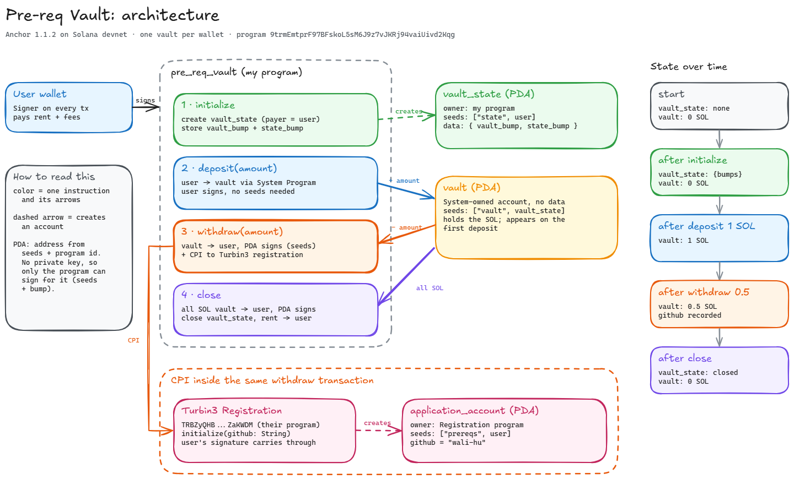

# Turbin3 Pre-req Vault

An Anchor program on Solana devnet that gives every wallet its own SOL vault. I extended the
`withdraw` instruction so that, in the same transaction, it makes a Cross-Program Invocation (CPI)
to Turbin3's registration program and records my GitHub username (`wali-hu`) on-chain.

This is my submission for Part 1 of the Turbin3 Q4 2026 Builders Cohort prerequisite challenge.
The base vault comes from [ShrinathNR/pre-req-vault](https://github.com/ShrinathNR/pre-req-vault).

| | |
|---|---|
| Vault program (mine, devnet) | [`9trmEmtprF97BFskoL5sM6J9z7vJKRj94vaiUivd2Kqg`](https://explorer.solana.com/address/9trmEmtprF97BFskoL5sM6J9z7vJKRj94vaiUivd2Kqg?cluster=devnet) |
| Turbin3 registration program | [`TRBZyQHB3m68FGeVsqTK39Wm4xejadjVhP5MAZaKWDM`](https://explorer.solana.com/address/TRBZyQHB3m68FGeVsqTK39Wm4xejadjVhP5MAZaKWDM?cluster=devnet) |
| Wallet that signed and registered | `C9bL9g4ktPxankL33SBP5viLFNgdDVSJMAM1G7dMb64y` |
| Framework | Anchor 1.1.2, Solana CLI 3.0.13 |

## Architecture



The editable source is [`docs/architecture.excalidraw`](docs/architecture.excalidraw) (open it on
excalidraw.com).

### Accounts

| Account | Kind | Seeds | Owner | What it holds |
|---|---|---|---|---|
| `user` | Signer | | System Program | Signs every transaction, pays rent and fees |
| `vault_state` | PDA | `["state", user]` | Vault program | `vault_bump: u8`, `state_bump: u8` |
| `vault` | PDA, `SystemAccount` | `["vault", vault_state]` | System Program | Only lamports, no data |
| `application_account` | PDA | `["prereqs", user]` | Registration program | `user`, `bump`, `pre_req_ts`, `pre_req_rs`, `github` |

A PDA (Program Derived Address) is derived from seeds plus a program ID and is pushed off the
ed25519 curve with a one-byte bump, so no private key exists for it. The vault program signs for
the `vault` PDA by passing its seeds and stored bump (`invoke_signed`). That is why only the
program can move SOL out of a vault, and why each wallet gets its own pair of accounts.

### Instructions

| Instruction | What it does |
|---|---|
| `initialize` | Creates `vault_state` (paid by the user) and stores both canonical bumps so later instructions do not have to search for them again. The `vault` is only derived here; it appears on-chain with the first deposit. |
| `deposit(amount)` | System Program transfer `user -> vault`. A plain CPI: the user already signed the transaction. |
| `withdraw(amount)` | System Program transfer `vault -> user`, signed by the vault PDA. Then a CPI to the registration program's `initialize` with my GitHub username. |
| `close` | Moves all lamports `vault -> user` (PDA signs) and closes `vault_state` with `close = user`, so its rent goes back to the user too. |

### State over time

```
start           vault_state: none      vault: 0 SOL     registration: none
initialize      vault_state: {bumps}   vault: 0 SOL
deposit 1 SOL   vault_state: {bumps}   vault: 1 SOL
withdraw 0.5    vault_state: {bumps}   vault: 0.5 SOL   registration: github = "wali-hu"
close           vault_state: closed    vault: 0 SOL     registration stays
```

## The change: CPI in `withdraw`

[`programs/pre-req-vault/src/instructions/withdraw.rs`](programs/pre-req-vault/src/instructions/withdraw.rs)

```rust
const GITHUB_USERNAME: &str = "wali-hu";

// after the vault -> user transfer:
let register_accounts = Initialize {
    user: self.user.to_account_info(),
    account: self.application_account.to_account_info(),
    system_program: self.system_program.to_account_info(),
};

let register_ctx = CpiContext::new(self.application_program.key(), register_accounts);

initialize(register_ctx, GITHUB_USERNAME.to_string())?;
```

- `declare_program!(registration)` reads [`idls/registration.json`](idls/registration.json) at
  compile time and generates the typed CPI client (`registration::cpi::initialize` and
  `registration::cpi::accounts::Initialize`).
- `CpiContext::new`, not `new_with_signer`: the registration program needs `user` as a signer,
  and the user's signature on the outer transaction carries into the CPI. Signer seeds are only
  needed when a PDA signs, as in the vault transfer above it.
- Before the CPI runs, Anchor checks that `application_account` matches the seeds
  `["prereqs", user]` under `application_program`, and that `application_program` is the
  registration program ID. A wrong account or a fake program is rejected.
- Both steps are in one transaction. If the registration fails, the withdrawal fails too.

Other changes: my own program ID in `declare_id!` and `Anchor.toml`, and a dedicated wallet in
`Anchor.toml`. The tests in [`tests/pre-req-vault.ts`](tests/pre-req-vault.ts) are unchanged.

## Devnet run

Deployed with `anchor deploy --provider.cluster devnet`, then:

```
$ anchor test --skip-build --skip-deploy --skip-local-validator --provider.cluster devnet

  pre-req-vault
    ✔ Initialize the vault
    ✔  Deposilt 1 Sol in to the vault
    ✔  Withdraw 0.5 Sol from the vault
    ✔  Close the vault and withdraw all the funds

  4 passing (18s)
```

| Step | Transaction |
|---|---|
| Initialize | [`3QJL3yaE...6ZdhzsvE1p`](https://explorer.solana.com/tx/3QJL3yaEa8HyGvMp4YvR3DLJL5fBNb1CxTjMmfWweCPomMaCBr9neVv5JDyFc4x2Z7EwfSrJtZME8s6ZdhzsvE1p?cluster=devnet) |
| Deposit 1 SOL | [`528BVPVN...ErZN4ekRVe`](https://explorer.solana.com/tx/528BVPVNwvBhCAPRfBf2B84dNpQ5wCh96TiRq7brX7Na7ft9qx1pDsFPt3dx8fuiVYPCu9dsa9Ms8HErZN4ekRVe?cluster=devnet) |
| **Withdraw + registration CPI** | [`4b7spgnG...mWTh1twdiA`](https://explorer.solana.com/tx/4b7spgnGp766y2i4FMKxCpJd4KXYhSrzxoANKELEqE7YXRyk5kQr4M9DRoUseLL4vC7yPzeCFsjsawmWTh1twdiA?cluster=devnet) |
| Close | [`2GyzKUfu...xYG73vkSvy`](https://explorer.solana.com/tx/2GyzKUfuKTxgdYrquo81SEGaxwUvehJUpeZ9LmMuDsegfY4FQASwRCtjv2jMchTFty9wbRkS1RypjjxYG73vkSvy?cluster=devnet) |

Logs of the withdraw transaction. The registration program runs at depth `[2]`, inside my
program, not as a direct call:

```
Program 9trmEmtprF97BFskoL5sM6J9z7vJKRj94vaiUivd2Kqg invoke [1]
Program log: Instruction: Withdraw
Program 11111111111111111111111111111111 invoke [2]
Program 11111111111111111111111111111111 success
Program TRBZyQHB3m68FGeVsqTK39Wm4xejadjVhP5MAZaKWDM invoke [2]
Program log: Instruction: Initialize
Program 11111111111111111111111111111111 invoke [3]
Program 11111111111111111111111111111111 success
Program TRBZyQHB3m68FGeVsqTK39Wm4xejadjVhP5MAZaKWDM consumed 9777 of 187783 compute units
Program TRBZyQHB3m68FGeVsqTK39Wm4xejadjVhP5MAZaKWDM success
Program 9trmEmtprF97BFskoL5sM6J9z7vJKRj94vaiUivd2Kqg consumed 22367 of 200000 compute units
Program 9trmEmtprF97BFskoL5sM6J9z7vJKRj94vaiUivd2Kqg success
```

Resulting registration account
[`7Vct2mHxE9sVXwj2MmgHiEgfUoGvBDUNUTamzHLi9h33`](https://explorer.solana.com/address/7Vct2mHxE9sVXwj2MmgHiEgfUoGvBDUNUTamzHLi9h33?cluster=devnet),
decoded:

```
owner:      TRBZyQHB3m68FGeVsqTK39Wm4xejadjVhP5MAZaKWDM
user:       C9bL9g4ktPxankL33SBP5viLFNgdDVSJMAM1G7dMb64y
pre_req_ts: false
pre_req_rs: false
github:     wali-hu
```

## Run it yourself

Requirements: Rust, Solana CLI 3.x, Anchor CLI 1.1.2 (`avm install 1.1.2 && avm use 1.1.2`),
Node and pnpm. Set `wallet` in `Anchor.toml` to your own keypair.

Registration is once per wallet, so test on a local validator first. It clones the real
registration program from devnet:

```bash
pnpm install
anchor build

solana-test-validator --reset \
  --url https://api.devnet.solana.com \
  --clone-upgradeable-program TRBZyQHB3m68FGeVsqTK39Wm4xejadjVhP5MAZaKWDM \
  --bpf-program <YOUR_PROGRAM_ID> target/deploy/pre_req_vault.so

# in a second terminal
solana airdrop 10 <YOUR_WALLET> --url localhost
anchor test --skip-local-validator --skip-deploy --skip-build --provider.cluster localnet
```

Then on devnet (run the test only once per wallet; a second withdraw fails because the
registration account already exists):

```bash
anchor deploy --provider.cluster devnet
anchor test --skip-build --skip-deploy --skip-local-validator --provider.cluster devnet
```

To deploy under your own program ID, run `anchor keys sync` after the first build and rebuild.

## Layout

```
programs/pre-req-vault/src/
  lib.rs                    program entry, 4 instructions
  state.rs                  VaultState { vault_bump, state_bump }
  instructions/
    initialize.rs
    deposit.rs
    withdraw.rs             vault transfer + registration CPI
    close.rs
idls/registration.json      Turbin3 registration IDL used by declare_program!
tests/pre-req-vault.ts      TypeScript tests (anchor test)
docs/                       architecture diagram (.png and .excalidraw)
```
